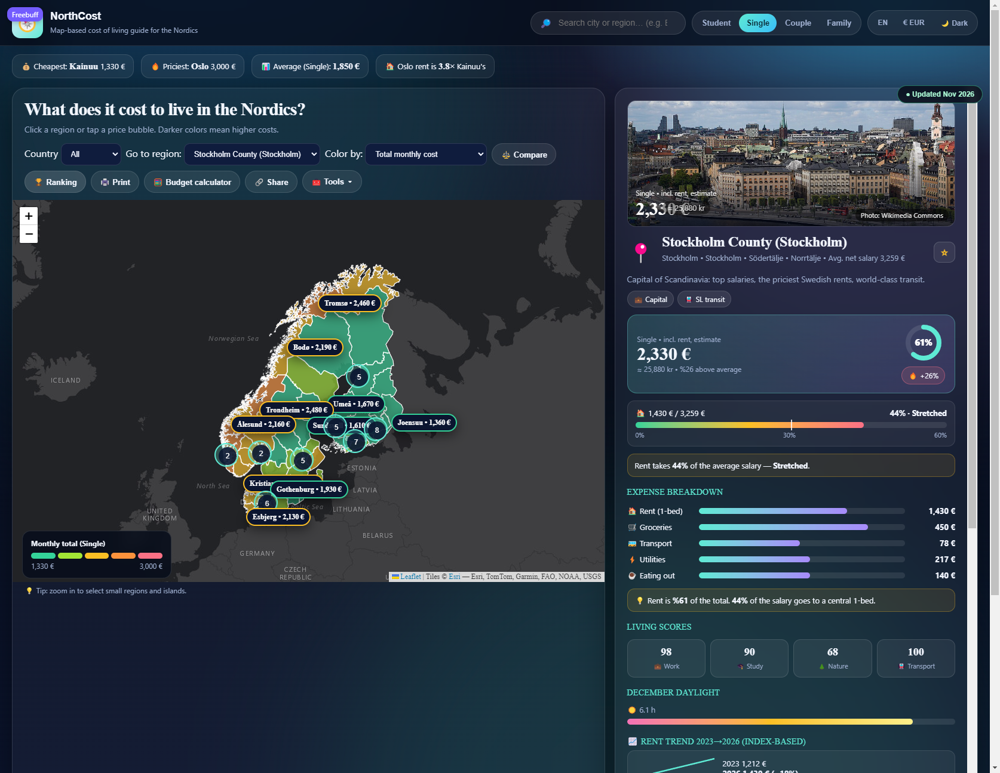
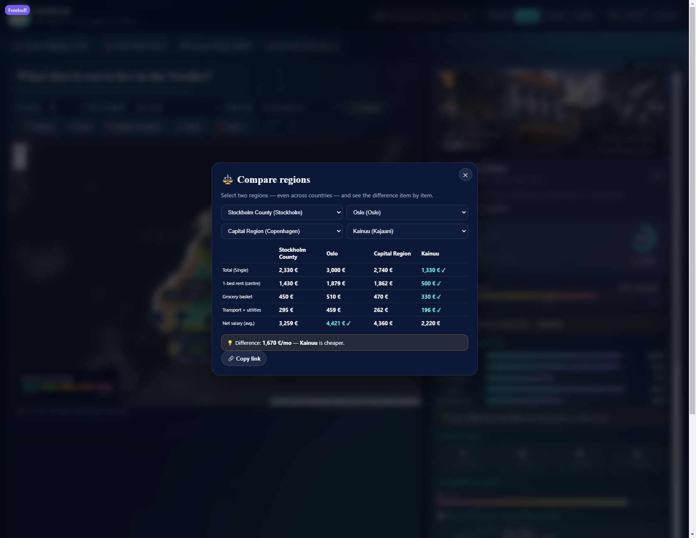
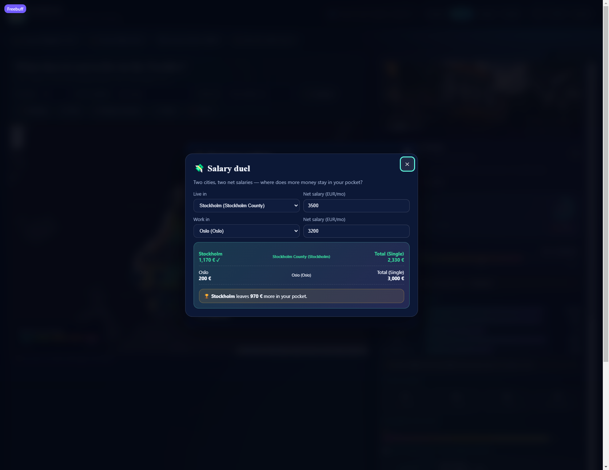

# NorthCost — Cost of Living Across the Nordics

**NorthCost** is a free, interactive, map-based cost-of-living guide for the Nordics.
Click any region on the map and instantly see what everyday life costs there:
rent, groceries, transport, utilities, salaries, daylight, climate and more —
across **Finland, Sweden, Norway and Denmark (60 regions, 50 cities)**.

🌍 **Live demo:** https://erdalbirinci.github.io/NorthCost/



No accounts, no tracking, no paywall. All figures are estimates for
information only, based on official national statistics (November 2026 level).

---

## ✨ Features

### 🗺️ Interactive cost map
- 60 region polygons (FI maakunnat, SE län, NO fylker, DK regioner) with
  heat colors, price bubbles and clustering
- Color the map by **total monthly cost, 1-bed rent, grocery basket,
  transport + utilities, or rent burden (rent ÷ salary)**
- Search any city or region, fly to it, filter by country
- 4 household profiles: **Student · Single · Couple · Family**
- 5 interface languages: **EN · FI · SV · NO · DA**, currency in
  **EUR / USD / local (kr)**

### ⚖️ 4-way region comparison
Compare up to **4 regions — even across countries** — item by item, with
automatic winner highlighting and a plain-language verdict. Every comparison
has a **shareable link** (`?cmp=id1,id2,…`) that re-opens the exact setup.



### 🏆 Region ranking
Sortable leaderboard of all 60 regions by total cost, rent, salary,
rent burden or December daylight. Click any row to jump to that region.

### 💸 Salary duel
Two cities, two **net** salaries — the simulator subtracts the local
single-person budget from each paycheck and shows where more money stays
in your pocket.



### 🧭 Find-my-match quiz
Answer 3 questions (who you are, what matters most, monthly budget cap)
and get your top-3 regions, scored from the app's living-score model.

### 📈 Rent trend 2023 → 2026
Each region panel shows an indexed rent-trend sparkline built from official
national rent indices:

| Country | Source | Cumulative 2023→2026 |
|---|---|---|
| 🇸🇪 Sweden | SCB hyresstatistik (+4.1 / +5.0 / +4.6 / +3.3 %) | **+18 %** |
| 🇳🇴 Norway | SSB LMU/KPI + Eiendom Norge | **≈ +16 %** |
| 🇩🇰 Denmark | DST huslejeindeks (2021=100 → 111.9) | **≈ +12 %** |
| 🇫🇮 Finland | StatFi rents of dwellings | **+2 % capital / +5 % rest** |

### 🌤️ Live climate & heating hint
Real January averages + current temperature via Open-Meteo, with an extra
heating-budget warning below −3 °C.

### 🧰 …and more
Budget calculator · net-salary guide · commute & student & family guides ·
compare-to-home tool · printable budget report · user price-fix suggestions ·
local job-board links (Platsbanken, NAV Arbeidsplassen, Jobnet, EURES) ·
offline-capable PWA · shareable deep links for everything.

---

## 📊 Data & methodology

- **Price levels:** November 2026 — national Q3 2026 rent statistics, 2026
  transit fares, EU fuel bulletin, ECB November 2026 reference rates.
- **Geometries:** Finland (attez/jsonmaps-finland), Sweden
  (GioPalusa/SwedenGeoJSON), Norway (robhop/fylker-og-kommuner), Denmark
  (Eurostat GISCO NUTS, vendored in `public/geo/`).
- **Basemap tiles:** OpenStreetMap, OpenTopoMap, Esri (Imagery + Dark Gray) —
  all free, **no API key required**. If a tile provider ever starts failing,
  the app automatically detects it and falls back to OSM Standard.
- Salaries are **average net estimates**; figures are rounded estimates,
  not quotes. See *Sources* inside the app for the full list.

### Data provenance: official statistics vs market estimates

Honest labelling matters more than false precision. Each figure is one of two kinds:

| Kind | Items | Basis |
|---|---|---|
| ✅ **Official statistics** | Utilities/electricity, transit passes, district heating, national rent levels, rent trends, daylight, climate | SSB (NO), SCB (SE), Statistics Denmark / Landsbyggefonden (DK), Statistics Finland (FI), HSL/Ruter/SL/DOT fare sheets, Open-Meteo |
| 📊 **Market / listing estimates** | City-centre 1-bedroom rents for capital and major cities | 2026 asking rents from live listing portals (Bolighub DK, hyresdata SE, Finn NO), plus city cost surveys |

Why the split: national statistics offices publish rent *levels* by region and room count, but not "city-centre 1-bedroom" for every city — and in Sweden/Denmark the regulated first-hand stock differs sharply from what a newcomer actually pays. Where only a market figure exists, the app uses the asking rent and labels it as an estimate. Norway utilities are computed from official SSB price (≈121 øre/kWh after support) × official consumption (159 kWh/m²/yr for a block flat), plus fixed grid charges.

---

## 🛠️ Run locally

```sh
npm install
npm run dev      # → http://127.0.0.1:5173/
npm run build    # → dist/
```

No framework, no backend, no secrets. Static files only.

## 📁 Project structure

```
index.html          # page shell + all modals
src/
  main.js           # all app logic (map, panels, tools, URL state)
  data.js           # Finland: 19 regions, cities, currencies, rates
  data_nordic.js    # Sweden/Norway/Denmark: 41 regions + cities
  extra.js          # per-region extras (photos, daylight, transit…)
  i18n.js           # EN/FI/SV/NO/DA strings (no service names in UI)
  style.css / extra.css
public/
  geo/dk-regions.geojson   # vendored Denmark boundaries
  sw.js / manifest.webmanifest / icons/   # PWA
docs/screenshots/   # images used in this README
.github/workflows/deploy.yml  # GitHub Pages deploy
```

## 🚀 Deployment

Pushing to `main` automatically builds and deploys to GitHub Pages
(`https://<user>.github.io/NorthCost/`) via the workflow in
`.github/workflows/deploy.yml`. The Vite `base` is set to `/NorthCost/`
for the project-site subpath.

## 🇫🇮 Suomeksi

**NorthCost** on ilmainen, interaktiivinen elinkustannusten karttaopas
Pohjoismaihin. Klikkaa mitä tahansa aluetta kartalla ja näe heti, mitä arki
siellä maksaa: vuokrat, ruoka, liikenne, sähkö, palkat, päivänvalo, ilmasto
ja paljon muuta — **Suomessa, Ruotsissa, Norjassa ja Tanskassa
(60 aluetta, 50 kaupunkia)**.

🌍 **Live-demo:** https://erdalbirinci.github.io/NorthCost/

- 🗺️ Lämpökartta 60 alueesta + hintakuplat; väritys viidellä mittarilla
- ⚖️ Jopa **4 alueen vertailu** jopa maiden välillä + jaettava linkki
- 🏆 **Ranking**-taulukko kaikista alueista (klikkaa otsikkoa järjestääksesi)
- 💸 **Palkkakaksintaistelu**: kaksi kaupunkia, kaksi nettopalkkaa
- 🧭 **Aluevisa**: 3 kysymystä → 3 parasta aluetta sinulle
- 📈 **Vuokratrendi 2023 → 2026** virallisista vuokraindekseistä
  (SE +18 %, NO ~+16 %, DK ~+12 %, FI +2 % pääkaupunki / +5 % muu maa)
- 🌤️ Todellinen ilmasto (Open-Meteo) + lämmitysvaroitus
- 🖨️ Tulostettava budjettiraportti, ✏️ hintakorjausehdotukset,
  💼 paikalliset työpaikkalinkit, offline-PWA
- 5 kieltä (EN · FI · SV · NO · DA), valuutta EUR / USD / paikallinen (kr)
- Kaikki karttatasot ilmaisia, **ei API-avainta tarvita**

```sh
npm install
npm run dev      # → http://127.0.0.1:5173/
```

## 🇸🇪 På svenska

**NorthCost** är en gratis, interaktiv kartguide över levnadskostnader i
Norden. Klicka på valfri region och se direkt vad vardagen kostar där:
hyror, mat, transport, el, löner, dagsljus, klimat och mycket mer — i
**Finland, Sverige, Norge och Danmark (60 regioner, 50 städer)**.

🌍 **Live-demo:** https://erdalbirinci.github.io/NorthCost/

- 🗺️ Värmekarta över 60 regioner + prisbubblor; färglägg med fem mått
- ⚖️ Jämför upp till **4 regioner** även mellan länder + delbar länk
- 🏆 **Rankningstabell** över alla regioner (klicka för att sortera om)
- 💸 **Löneduell**: två städer, två nettolöner
- 🧭 **Regionsquiz**: 3 frågor → dina 3 bästa regioner
- 📈 **Hyrestrend 2023 → 2026** från officiella hyresindex
  (SE +18 %, NO ~+16 %, DK ~+12 %, FI +2 % huvudstad / +5 % övriga)
- 🌤️ Verkligt klimat (Open-Meteo) + värmevarning
- 🖨️ Utskrivbar budgetrapport, ✏️ prisförslag från användare,
  💼 lokala jobblänkar, offline-PWA
- 5 språk (EN · FI · SV · NO · DA), valuta EUR / USD / lokal (kr)
- Alla kartlager är gratis, **ingen API-nyckel krävs**

```sh
npm install
npm run dev      # → http://127.0.0.1:5173/
```

## 📄 License

MIT — see [LICENSE](LICENSE). Fork it, translate it, make it yours.
Attribution appreciated.
